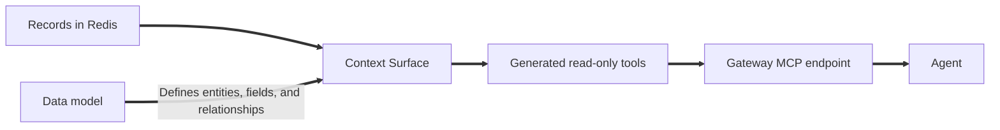

Make records stored in Redis available to agents through read-only tools.

A Context Surface is an Upstream that generates tools from a data model describing your records, searchable fields, and relationships. Agents call these tools through the Gateway's Model Context Protocol (MCP) endpoint.

Creating a Surface does not import records. Load your records into the source database first.



## Before you begin

The examples use a self-managed deployment. You need:

- A Gateway, its administration URL, and an admin token. See [Manage Gateways and Upstreams](/content/develop/ai/context-engine/context-gateway/manage-gateways.md#before-you-begin).
- A registered source database and its ID.
- Records that match your data model, loaded into that database.
- The Iris command-line interface (CLI), installed from the Python `redis-iris` package. See [SDK and CLI setup](/content/develop/ai/context-engine/sdk-and-cli.md).
- `jq`, plus cURL for the HTTP examples.

Set the connection values:

```bash
export IRIS_CONTEXT_GATEWAY_SERVICE_URL='<administration-url>'
export IRIS_CONTEXT_GATEWAY_SERVICE_TOKEN='<admin-token>'
export IRIS_CONTEXT_GATEWAY_ID='<gateway-id>'
export SURFACE_DATABASE_ID='<surface-database-id>'
export SURFACE_GATEWAY_API="$IRIS_CONTEXT_GATEWAY_SERVICE_URL/iris/v1/context-gateway/gateways/$IRIS_CONTEXT_GATEWAY_ID"
```

## Choose a source database

Your administrator registers the source database and gives the Control Plane and Data Plane each a Redis user for it. You supply the registry ID when creating a Surface, without an endpoint or credentials. See [Context Surface databases](/content/operate/iris/context-gateway/self-managed/configuration.md#context-surface-databases).

Check these access boundaries before choosing a database:

| Boundary | What it means for your application |
| --- | --- |
| Gateway access | Every agent with access to a Gateway can read every record of every Surface on it. |
| Access tags | Context Surfaces do not narrow results by access tags. |
| Shared source database | Gateways whose Surfaces share a database can read each other's records. Use separate databases when records must stay separate. |
| Gateway storage | The source database must be separate from the Gateway database used for cache and compression. Never use one Redis database for both. |

The examples supply `contextSurface.databaseId` explicitly. Database selection follows these rules:

| Value | Result |
| --- | --- |
| Explicit database ID | Uses that database, overriding any default. |
| Omitted on self-managed with a default | Uses the configured default Surface database. |
| Omitted on self-managed without a default | Returns `400` for `contextSurface.databaseId`. |
| Empty string or `null` | Returns `400` for `contextSurface.databaseId`. |
| Omitted on Redis Cloud | Returns an error. Redis Cloud requires an explicit ID. |

The response includes the resolved ID in `contextSurface.databaseBinding.databaseId` and the database name in `contextSurface.databaseBinding.name`. The name is absent if its lookup fails. See [Default databases](/content/operate/iris/context-gateway/self-managed/configuration.md#default-databases).

## Describe your records

A data model tells the Gateway which records to expose and how agents can query them.

| Model element | Purpose |
| --- | --- |
| Entity | A type of record, such as a provider or location. |
| Redis key template | Identifies the keys that store an entity's records. |
| Key component | A field used to construct the record's key for lookup by ID. |
| TAG index | Makes a field available for filtering, such as providers by specialty. |
| TEXT index | Makes a field available for text search, such as locations by name. |
| Relationship | Links an entity to another through a field, such as a provider's home location. |

The clinic model has two entities: `Location` and `Provider`. Providers have a specialty and a home location. Locations have a name and city.

### Write the data model {#write-a-data-model}

Save this model as `clinic-model.json`:

```json
{
  "title": "Healthcare scheduling",
  "description": "Clinics and the providers who work at them",
  "entities": [
    {
      "name": "Location",
      "description": "A medical facility where providers see patients",
      "redis_key_template": "location:{id}",
      "fields": [
        {"name": "id", "type": "str", "description": "Location ID", "is_key_component": true, "redis_indices": []},
        {"name": "name", "type": "str", "description": "Facility name", "redis_indices": [{"type": "text", "weight": 1.0}]},
        {"name": "city", "type": "str", "description": "City", "redis_indices": [{"type": "tag"}]}
      ],
      "relationships": []
    },
    {
      "name": "Provider",
      "description": "A clinician who sees patients at one location",
      "redis_key_template": "provider:{id}",
      "fields": [
        {"name": "id", "type": "str", "description": "Provider ID", "is_key_component": true, "redis_indices": []},
        {"name": "specialty", "type": "str", "description": "Specialty", "redis_indices": [{"type": "tag"}]},
        {"name": "location_id", "type": "str", "description": "Home location", "redis_indices": [{"type": "tag"}]}
      ],
      "relationships": [
        {"name": "works_at", "target": "Location", "description": "The provider's home location", "source_field": "location_id"}
      ]
    }
  ],
  "entity_count": 2
}
```

### Check model limits

| Limit | What to do |
| --- | --- |
| At most 1 mebibyte (MiB) of JSON | Keep the model within this size. |
| One Redis index per field | To search the same value with both TAG and TEXT, store it in two fields and give each field one index. |
| No `acl_field_mappings` | Omit this unsupported field. The Control Plane rejects models that include it. |

### Prepare text values

Normalize line breaks to spaces in TEXT-indexed values before loading records. Redis TEXT tokenization does not reliably turn every line-break form into a word boundary. Include CRLF, LF, CR, vertical tab, form feed, U+0085, U+2028, and U+2029 in your normalization.

Rewrite existing records with normalized values. Refreshing the catalog or rebuilding an index alone does not change stored text.

Test representative queries against your indexed data. Do not assume punctuation-containing phrases have literal phrase-search semantics.

### Load the records

The [self-managed API examples](/content/operate/iris/context-gateway/self-managed/api-examples.md) show how to load the clinic records used by the quickstart. If you also created the Surface there, make sure the connection values in [Before you begin](#before-you-begin) identify that same Gateway. From the directory containing the setup response files, load its Surface ID:

```bash
export SURFACE_ID="$(jq -er '.upstreamId' "surface-$IRIS_CONTEXT_GATEWAY_ID.json")"
```

Then skip to [Verify the generated tools](#verify-the-generated-tools).

## Create a Context Surface

Create an Upstream of kind `CONTEXT_SURFACE` with the database ID and data model. The `scheduling` namespace identifies its tools in the Gateway catalog.



```bash
iris --json context-gateway upstream add \
  --kind context-surface --name 'Healthcare scheduling' --namespace scheduling \
  --surface-database-id "$SURFACE_DATABASE_ID" --data-model clinic-model.json > surface.json

export SURFACE_ID="$(jq -er '.upstreamId' surface.json)"
jq '{upstreamId, revision, initialCatalogFailure}' surface.json
```

-tab-sep-

```bash
jq -n --arg database "$SURFACE_DATABASE_ID" --slurpfile model clinic-model.json \
  '{name: "Healthcare scheduling", namespace: "scheduling", kind: "CONTEXT_SURFACE",
    contextSurface: {databaseId: $database, dataModel: $model[0]}}' > surface-create.json

curl --fail-with-body --silent --show-error \
  -X POST "$SURFACE_GATEWAY_API/upstreams" \
  -H "Authorization: Bearer $IRIS_CONTEXT_GATEWAY_SERVICE_TOKEN" \
  -H 'Content-Type: application/json' \
  --data-binary @surface-create.json > surface.json
export SURFACE_ID="$(jq -er '.upstreamId' surface.json)"
jq '{upstreamId, revision, initialCatalogFailure}' surface.json
```



### Check the creation result

Registration, tool publication, and indexing are separate outcomes. The Control Plane generates and publishes tools during the create request. If generation fails, registration still succeeds with HTTP `201`, and `initialCatalogFailure` explains the problem:

| `initialCatalogFailure.status` | Meaning | What to do |
| --- | --- | --- |
| `422` | The Surface database refused the login. | Ask your administrator to fix the registry login, then refresh. |
| `424` | The Surface database was unreachable, answered an error, or refused a command. | Ask your administrator to check the database and its Redis users, then refresh. |
| `408` | Tool generation timed out. | Refresh. |
| `423` | The Gateway or its tenant was suspended. | Refresh once the suspension ends. |

A `400` response identifies invalid members in `errors[]`. A body member uses a JSON Pointer in `pointer`, such as `/contextSurface/dataModel`, and a human-readable `detail`. The response does not echo rejected credentials or database addresses. Nothing was written.

Tools can be published while background indexing is still running. Search results can be incomplete until indexing finishes.

## Verify the generated tools

<a id="list-the-generated-tools"></a>

List the Surface's tool catalog:



```bash
iris context-gateway upstream tools "$SURFACE_ID"
```

-tab-sep-

```bash
curl --fail-with-body --silent --show-error \
  "$SURFACE_GATEWAY_API/upstreams/$SURFACE_ID/tools" \
  -H "Authorization: Bearer $IRIS_CONTEXT_GATEWAY_SERVICE_TOKEN" | jq .
```



Every generated tool is read-only. Agents see tools under the Surface's namespace, for example `scheduling__filter_provider`.

Use MCP discovery to inspect each tool's input schema before calling it, as shown in the [quickstart](/content/develop/ai/context-engine/context-gateway/quickstart.md).

| Agent task | Model support |
| --- | --- |
| Filter providers by specialty or location | TAG indexes on `Provider.specialty` and `Provider.location_id`. |
| Search location names | TEXT index on `Location.name`. |
| Filter locations by city | TAG index on `Location.city`. |
| Look up a record by ID | Redis key template and key component. |

The Provider model has no TEXT-indexed field, so it supports filtering rather than text search. A lookup for an ID that does not exist succeeds and returns `null`.

### Allow indexing to finish

Creating a Surface, updating its model, or refreshing it starts background indexing. A published tool catalog does not mean indexing is complete. Wait for indexing to finish before checking result completeness. If results remain incomplete, ask your administrator to inspect the source database's indexes.

## Update the data model {#change-the-data-model-or-refresh}

Edit `clinic-model.json`, then submit the complete replacement model. The CLI reads the current revision for the update. With HTTP, read it yourself and send it as `expectedRevision`.



```bash
iris context-gateway upstream update "$SURFACE_ID" --data-model clinic-model.json
```

-tab-sep-

```bash
curl --fail-with-body --silent --show-error \
  "$SURFACE_GATEWAY_API/upstreams/$SURFACE_ID" \
  -H "Authorization: Bearer $IRIS_CONTEXT_GATEWAY_SERVICE_TOKEN" > surface.json

jq -n --arg revision "$(jq -er '.revision' surface.json)" \
  --slurpfile model clinic-model.json \
  '{expectedRevision: $revision, contextSurface: {dataModel: $model[0]}}' > surface-update.json

curl --fail-with-body --silent --show-error \
  -X PATCH "$SURFACE_GATEWAY_API/upstreams/$SURFACE_ID" \
  -H "Authorization: Bearer $IRIS_CONTEXT_GATEWAY_SERVICE_TOKEN" \
  -H 'Content-Type: application/json' \
  --data-binary @surface-update.json > surface.json
```



The model and generated tools commit together. Subsequent discovery returns the new tools, although indexing can still be underway.

A stale revision returns `412`. Read the resource again and reconcile your change before retrying.

## Refresh the tools

Refresh a Surface to generate tools from its stored model and recreate missing indexes.

| Change or problem | Action |
| --- | --- |
| New entities, fields, indexes, or relationships | Update the data model. |
| Initial tool generation failed | Fix the reported problem, then refresh. |
| A database index is missing | Refresh to recreate it. |
| Stored text contains line breaks | Rewrite the values. A refresh alone does not normalize them. |



```bash
iris context-gateway upstream refresh "$SURFACE_ID"
```

-tab-sep-

```bash
curl --fail-with-body --silent --show-error \
  -X POST "$SURFACE_GATEWAY_API/upstreams/$SURFACE_ID/refresh" \
  -H "Authorization: Bearer $IRIS_CONTEXT_GATEWAY_SERVICE_TOKEN" \
  > surface-refresh-response.json
```



A tool call during a model update or refresh can fail with `upstream_error` while its index is replaced. Retry the read-only call after the operation finishes.

[Verify the catalog](#verify-the-generated-tools) and allow indexing to finish before checking results.

## Delete a Context Surface

Deleting a Surface removes its registration and drops its indexes from the source database. The CLI reads the current revision and asks for confirmation. With HTTP, read the revision before deleting:



```bash
iris context-gateway upstream delete "$SURFACE_ID"
```

-tab-sep-

```bash
curl --fail-with-body --silent --show-error \
  "$SURFACE_GATEWAY_API/upstreams/$SURFACE_ID" \
  -H "Authorization: Bearer $IRIS_CONTEXT_GATEWAY_SERVICE_TOKEN" > surface.json

curl --fail-with-body --silent --show-error \
  -X DELETE "$SURFACE_GATEWAY_API/upstreams/$SURFACE_ID?expectedRevision=$(jq -er '.revision | @uri' surface.json)" \
  -H "Authorization: Bearer $IRIS_CONTEXT_GATEWAY_SERVICE_TOKEN"
```



### If index cleanup fails

If deletion repeatedly returns `503` because indexes cannot be dropped, remove the registration with the index-cleanup override. This leaves the indexes in the database. Ask your administrator to remove them afterward.



```bash
iris context-gateway upstream delete "$SURFACE_ID" --ignore-index-sweep-failure
```

-tab-sep-

```bash
curl --fail-with-body --silent --show-error \
  -X DELETE "$SURFACE_GATEWAY_API/upstreams/$SURFACE_ID?expectedRevision=$(jq -er '.revision | @uri' surface.json)&ignoreIndexSweepFailure=true" \
  -H "Authorization: Bearer $IRIS_CONTEXT_GATEWAY_SERVICE_TOKEN"
```



## Next steps

- [Call a tool through the Gateway](/content/develop/ai/context-engine/context-gateway/quickstart.md).
- [Manage Gateways and Upstreams](/content/develop/ai/context-engine/context-gateway/manage-gateways.md).
- [Connect an agent](/content/develop/ai/context-engine/context-gateway/agent-integration.md).
- [Review limits and troubleshooting](/content/develop/ai/context-engine/context-gateway/limits.md).
