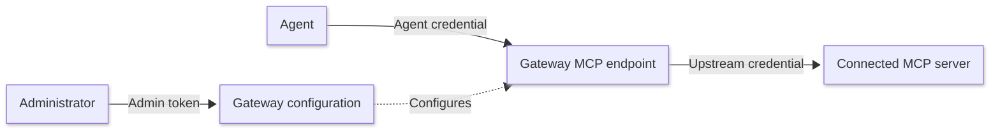

Create a Gateway, connect Model Context Protocol (MCP) servers, and configure how agents discover tools and receive results.

This guide covers administration on a self-managed deployment using the Iris command-line interface (CLI). For Redis Cloud, see [Create a Gateway](/content/operate/iris/context-gateway/create-gateway.md) and [Manage a Gateway](/content/operate/iris/context-gateway/manage-gateway.md).

To generate tools for records stored in Redis, see [Manage Context Surfaces](/content/develop/ai/context-engine/context-gateway/manage-context-surfaces.md).

## Before you begin

You need:

- A running Context Gateway deployment.
- Its administration URL and admin token.
- Python 3.11 or later.
- An MCP server that the Gateway can reach over Streamable HTTP.

Administrative requests configure the Gateway. Agents use a separate credential to discover and call tools through its MCP endpoint.



Install the unified Python SDK and CLI:

```bash
pip install redis-iris
```

Set the administration connection values:

```bash
export IRIS_CONTEXT_GATEWAY_SERVICE_URL='<administration-url>'
export IRIS_CONTEXT_GATEWAY_SERVICE_TOKEN='<admin-token>'
```

Use the administration base URL, including its scheme and host. The CLI adds the application programming interface (API) path.

The admin token manages every Gateway in the deployment. Keep it out of agent and application configuration. See [Authentication and authorization](/content/operate/iris/context-gateway/self-managed/authentication.md).

### Use the HTTP API

You can perform the same tasks through the Control Plane API. The HTTP examples use Bash, cURL, and jq. Define this helper in your shell:

```bash
export GATEWAY_API="$IRIS_CONTEXT_GATEWAY_SERVICE_URL/iris/v1/context-gateway"
umask 077

gateway_api() {
  local method="$1" path="$2"
  shift 2
  curl --fail-with-body --silent --show-error \
    -X "$method" "$GATEWAY_API$path" \
    -H "Authorization: Bearer $IRIS_CONTEXT_GATEWAY_SERVICE_TOKEN" \
    -H 'Content-Type: application/json' "$@"
}
```

API values are case-sensitive. Use `FULL` or `SEARCH`, and `ENABLED` or `DISABLED`, in JSON. CLI options accept the lowercase forms shown in this guide. For Python and TypeScript SDK choices, see [Choose a client](/content/develop/ai/context-engine/context-gateway/mcp.md#choose-a-client).

## Create a Gateway

Create a Gateway named Support in search mode. Start with caching and compression disabled so you can connect and verify its tools before configuring result handling.



```bash
iris context-gateway service create \
  --name Support \
  --tool-exposure-mode search \
  --cache disabled \
  --compression disabled \
  --no-key
```

Copy the returned Gateway ID:

```bash
export IRIS_CONTEXT_GATEWAY_ID='<gateway-id>'
```

The `--no-key` option creates the Gateway without minting an agent key.

-tab-sep-

```bash
gateway_api POST /gateways \
  --data '{
    "name": "Support",
    "toolExposureMode": "SEARCH",
    "cache": "DISABLED",
    "compression": "DISABLED"
  }' > gateway.json

export IRIS_CONTEXT_GATEWAY_ID="$(jq -er '.gatewayId' gateway.json)"
jq '{gatewayId, mcpEndpoint, revision}' gateway.json
```



Save the returned `mcpEndpoint` for agent connections. Gateway IDs begin with `gw_`, and Upstream IDs begin with `up_`. Copy returned IDs rather than constructing them.

### Database and feature defaults

A Gateway database stores cached results and handles. You can select one during creation with `--database-id` in the CLI or `databaseId` in the API.

| Creation setting | Behavior |
| --- | --- |
| No database specified | Uses the deployment’s default Gateway database, if configured. |
| No explicit or default database available | Caching and compression are disabled. |
| Database available and feature settings omitted | Caching and compression default to enabled, subject to compression capability checks. |
| Features explicitly disabled | They remain disabled, as in this example. |

For HTTP creation requests, an empty or `null` `databaseId` returns `400`. Responses expose the resolved database through `databaseBinding`, including its name when available.

See [Default databases](/content/operate/iris/context-gateway/self-managed/configuration.md#default-databases) for deployment configuration.

## Connect an MCP server {#register-an-mcp-server}

Register the server as an Upstream. Its endpoint must be reachable from the Gateway and permitted by the deployment’s outbound policy.

This example connects a server that accepts a bearer token:

```bash
export UPSTREAM_URL='<upstream-mcp-url>'
export UPSTREAM_TOKEN='<upstream-bearer-token>'
```



```bash
iris context-gateway upstream add \
  --name 'Support tools' \
  --namespace support \
  --endpoint "$UPSTREAM_URL" \
  --bearer-secret env:UPSTREAM_TOKEN
```

Copy the returned Upstream ID for recovery if deletion later stops partway:

```bash
export UPSTREAM_ID='<upstream-id>'
```

-tab-sep-

```bash
jq -n \
  --arg endpoint "$UPSTREAM_URL" \
  --arg token "$UPSTREAM_TOKEN" '{
    name: "Support tools",
    namespace: "support",
    kind: "MCP",
    mcp: {
      endpoint: $endpoint,
      transport: "streamable-http",
      authentication: {methods: [{bearer: {value: $token}}]}
    }
  }' > upstream-create.json

gateway_api POST "/gateways/$IRIS_CONTEXT_GATEWAY_ID/upstreams" \
  --data-binary @upstream-create.json > upstream.json

rm upstream-create.json
export UPSTREAM_ID="$(jq -er '.upstreamId' upstream.json)"
jq '{upstreamId, revision, initialCatalogFailure}' upstream.json
```



Remove the token from your shell when finished:

```bash
unset UPSTREAM_TOKEN
```

Credentials are write-only: inspecting an Upstream does not return their values. Do not print or retain request files containing credentials.

| Server authentication | CLI | HTTP configuration |
| --- | --- | --- |
| None | Omit authentication options | `"authentication": {"methods": []}` |
| Bearer token | `--bearer-secret env:UPSTREAM_TOKEN` | `{"bearer": {"value": "<upstream-key>"}}` in `authentication.methods` |
| Custom header | `--header X-Api-Key --header-secret env:UPSTREAM_TOKEN` | `{"header": {"name": "X-Api-Key", "value": "<upstream-key>"}}` in `authentication.methods` |

The namespace distinguishes this source’s tools from other Upstreams. Namespaces have at most 32 characters. A tool named `get_ticket` in the `support` namespace is exposed as `support__get_ticket`. Use names returned by discovery rather than recreating naming rules.

## Verify the available tools {#inspect-the-tool-catalog}

Inspect the Upstream and its catalog:



```bash
iris context-gateway upstream show support
iris context-gateway upstream tools support
```

-tab-sep-

```bash
gateway_api GET "/gateways/$IRIS_CONTEXT_GATEWAY_ID/upstreams/$UPSTREAM_ID" > upstream.json
gateway_api GET "/gateways/$IRIS_CONTEXT_GATEWAY_ID/upstreams/$UPSTREAM_ID/tools" > tools.json
jq . tools.json
```



Confirm that the catalog contains the tools you expect from the server.

Registration can succeed even when initial tool discovery fails. If the response includes `initialCatalogFailure`, correct the reported connection, authentication, or discovery problem, then [refresh the catalog](#refresh-or-disable-an-upstream):

```bash
iris context-gateway upstream refresh support
```

Inspect the catalog again before connecting an agent. A catalog listing confirms discovery. To verify execution, mint an agent key for this Gateway. Get the Identity Service administration URL and token from your administrator, then run:

```bash
export IRIS_IDENTITY_URL='<identity-service-url>'
export IRIS_IDENTITY_TOKEN='<identity-service-admin-token>'
iris context-gateway service key "$IRIS_CONTEXT_GATEWAY_ID" --write .env.gateway
```

The file contains the agent connection values. Keep it out of source control. See [Gateway authorization and grants](/content/operate/iris/context-gateway/self-managed/authentication.md#gateway-authorization-and-grants) for access requirements.

Load the connection values and discover tools on the search-mode Gateway created in this guide:

```bash
set -a
source .env.gateway
set +a
iris --json context-gateway tools search '*'
```

Choose a tool you intend to execute, inspect its input schema, and save matching arguments as a JSON object in `tool-input.json`. Call it by the name returned by discovery:

```bash
iris --json context-gateway tools call '<discovered-tool-name>' --input tool-input.json
```

Check that the result is successful and matches the source. For a separate walkthrough with prepared clinic data, see the [quickstart](/content/develop/ai/context-engine/context-gateway/quickstart.md).

## Find existing Gateways and Upstreams {#list-and-inspect-gateways-and-upstreams}

| Task | Command |
| --- | --- |
| List Gateways | `iris context-gateway service list` |
| Inspect the selected Gateway | `iris context-gateway service show "$IRIS_CONTEXT_GATEWAY_ID"` |
| List its Upstreams | `iris context-gateway upstream list` |
| Inspect an Upstream | `iris context-gateway upstream show support` |

An Upstream argument can be its namespace or returned ID.

Place `--json` immediately after `iris` when saving or processing output:

```bash
iris --json context-gateway upstream list
```

### List resources through HTTP

HTTP list operations return a page containing `items` and an optional `nextCursor`:

```bash
gateway_api GET '/gateways?limit=50' > gateways.json
jq '.items[] | {gatewayId, name}' gateways.json
```

Pass the returned cursor unchanged and URL-encoded to retrieve another page:

```bash
cursor="$(jq -r '.nextCursor // empty' gateways.json)"
if [ -n "$cursor" ]; then
  gateway_api GET /gateways --get \
    --data-urlencode 'limit=50' \
    --data-urlencode "cursor=$cursor" > gateways-next.json
fi
```

Use `/gateways/$IRIS_CONTEXT_GATEWAY_ID/upstreams` to list an Upstream page.

## Change a Gateway

Update a Gateway’s name or discovery mode:

```bash
iris context-gateway service update "$IRIS_CONTEXT_GATEWAY_ID" \
  --name 'Customer support' \
  --tool-exposure-mode search
```

Use `--tool-exposure-mode full` to expose all tool definitions directly. See [Tool exposure modes](/content/develop/ai/context-engine/context-gateway/concepts.md#tool-exposure-modes).

Clients receive the updated tool list when they next request it. Clients that cache definitions may need to refresh their local list.

### Handle concurrent changes

The CLI reads the current revision before changing or deleting a resource. If another administrator changes it first, the operation can fail with a revision conflict.

Inspect the resource again and reconcile your intended change before repeating the command.

For HTTP updates, read the resource and send its current revision as `expectedRevision`:

```bash
gateway_api GET "/gateways/$IRIS_CONTEXT_GATEWAY_ID" > gateway.json
jq '{expectedRevision: .revision, toolExposureMode: "SEARCH"}' gateway.json > update.json
gateway_api PATCH "/gateways/$IRIS_CONTEXT_GATEWAY_ID" \
  --data-binary @update.json > gateway.json
```

Treat revisions as opaque values, not counters. A stale revision returns `412` with problem type `/errors/revision-conflict`.

## Configure caching and compression {#turn-the-cache-and-compression-on-or-off}

Both features require a Gateway database and must be enabled in the deployment and on the Gateway.

Caching additionally requires a policy for each tool whose results you want to cache. Compression applies to eligible large results while enabled, unless a tool policy changes that behavior.

### Enable the Gateway features

Get the registered Gateway database ID from your administrator:

```bash
export GATEWAY_DATABASE_ID='<gateway-database-id>'
```



```bash
iris context-gateway service update "$IRIS_CONTEXT_GATEWAY_ID" \
  --database-id "$GATEWAY_DATABASE_ID" \
  --cache enabled \
  --compression enabled
```

-tab-sep-

```bash
gateway_api GET "/gateways/$IRIS_CONTEXT_GATEWAY_ID" > gateway.json
jq --arg database "$GATEWAY_DATABASE_ID" \
  '{expectedRevision: .revision, databaseId: $database, cache: "ENABLED", compression: "ENABLED"}' \
  gateway.json > update.json
gateway_api PATCH "/gateways/$IRIS_CONTEXT_GATEWAY_ID" --data-binary @update.json > gateway.json
```



The Gateway database stores cached results and handles. It is separate from a Context Surface’s source database.

| Change | What to configure | Result |
| --- | --- | --- |
| Add a database | Select the database and explicitly enable the features you want | Adding a database alone preserves existing feature settings. |
| Disable caching | `--cache disabled` | Cached entries remain subject to their time to live (TTL). |
| Disable compression | `--compression disabled` | Handle tools disappear from discovery. Stored handles remain subject to expiry. |
| Detach the database | Clear the binding and disable both features in the same update | The Gateway no longer uses that database for caching or compression. |

To detach the database:

```bash
iris context-gateway service update "$IRIS_CONTEXT_GATEWAY_ID" \
  --clear-database \
  --cache disabled \
  --compression disabled
```

For HTTP updates, send `databaseId: null`, `cache: "DISABLED"`, and `compression: "DISABLED"` with `expectedRevision`.

### Compression database requirements

Compression requires a reachable database with Redis JSON support and `maxmemory-policy noeviction`.

| Situation | Behavior |
| --- | --- |
| You explicitly enable compression with an unsuitable database | The request fails with `400`. An entry in `errors[]` has a `pointer` identifying `/compression`. |
| The database cannot be reached during an explicit enablement check | The request fails with `503`. |
| Gateway creation leaves compression unspecified and the capability check fails | The Gateway is created with compression disabled. |

See [Cache and compression](/content/operate/iris/context-gateway/self-managed/configuration.md#cache-and-compression) for deployment settings and memory limits.

## Set tool policies

Policies configure one tool within one Upstream. Use the tool’s exact original name from the Upstream catalog, such as `get_ticket`, rather than its exposed name `support__get_ticket`.

| Policy | CLI option | API field | Effect |
| --- | --- | --- | --- |
| Cache lifetime | `--cache-ttl` | `cache.ttlSeconds` | Reuse eligible results for 1 to 86400 seconds (24 hours). |
| Handle lifetime | `--compression-ttl` | `compression.ttlSeconds` | Retain captured results for 1 to 86400 seconds (24 hours). |
| Disable capture | `--compression-capture never` | `compression.capture: "NEVER"` | Ordinary calls return results inline. Explicit handle requests return a tool error. |

A tool’s compression policy can specify a lifetime or disable capture, but cannot do both. Its cache policy is independent.

### Cache a tool’s results

List tools eligible for caching:

```bash
iris context-gateway upstream tools support --cacheable-only
```

A tool declaring `readOnlyHint: false` or `destructiveHint: true` is not cacheable.

Enable caching on the Gateway, then set a policy:

```bash
iris context-gateway policy set support '<original-tool-name>' --cache-ttl 60s
```

Choose a lifetime that reflects how quickly the source data changes. All callers with access to the Gateway share its cache entries.

New or changed cache policies return `400` while Gateway caching is disabled. Existing unchanged policies can remain stored.

### Customize compression

Set a five-minute handle lifetime:

```bash
iris context-gateway policy set support '<original-tool-name>' --compression-ttl 5m
```

Alternatively, prevent capture for the tool:

```bash
iris context-gateway policy set support '<original-tool-name>' --compression-capture never
```

Inspect the policies:

```bash
iris context-gateway policy list support
```

Remove only the setting you want to clear. To remove the cache policy:

```bash
iris context-gateway policy clear support '<original-tool-name>' --cache
```

To remove the compression override instead:

```bash
iris context-gateway policy clear support '<original-tool-name>' --compression
```

Removing a compression override restores the Gateway’s default behavior for that tool.

### Preserve other policies in HTTP updates

The CLI preserves unrelated policies when updating a tool. With HTTP, preserve the existing policy map and the selected tool’s other settings yourself.

For example, this request changes only a tool’s cache lifetime:

```bash
export ORIGINAL_TOOL_NAME='<original-tool-name>'
gateway_api GET "/gateways/$IRIS_CONTEXT_GATEWAY_ID/upstreams/$UPSTREAM_ID" > upstream.json

jq --arg tool "$ORIGINAL_TOOL_NAME" '
  (.toolPolicies // {}) as $policies |
  {
    expectedRevision: .revision,
    toolPolicies: (
      $policies + {
        ($tool): (
          ($policies[$tool] // {}) + {
            cache: (($policies[$tool].cache // {}) + {ttlSeconds: 60})
          }
        )
      }
    )
  }
' upstream.json > update.json

gateway_api PATCH "/gateways/$IRIS_CONTEXT_GATEWAY_ID/upstreams/$UPSTREAM_ID" \
  --data-binary @update.json > upstream.json
```

If you change an Upstream’s endpoint, inspect the response’s `droppedToolPolicies`. Policies incompatible with the new catalog can be removed.

## Refresh or disable an Upstream

Refresh after adding, removing, or changing tools on the MCP server:



```bash
iris context-gateway upstream refresh support
```

-tab-sep-

```bash
gateway_api POST "/gateways/$IRIS_CONTEXT_GATEWAY_ID/upstreams/$UPSTREAM_ID/refresh" > upstream.json
```



A refresh publishes a new catalog revision. Cached results associated with the previous revision are no longer served.

### Disable or enable the tools {#enable-or-disable-an-upstream}

Temporarily remove the Upstream’s tools from discovery:



```bash
iris context-gateway upstream disable support
```

Restore them with:

```bash
iris context-gateway upstream enable support
```

-tab-sep-

```bash
gateway_api GET "/gateways/$IRIS_CONTEXT_GATEWAY_ID/upstreams/$UPSTREAM_ID" > upstream.json
jq '{expectedRevision: .revision, enabled: false}' upstream.json > update.json
gateway_api PATCH "/gateways/$IRIS_CONTEXT_GATEWAY_ID/upstreams/$UPSTREAM_ID" \
  --data-binary @update.json > upstream.json
```

To restore the tools, read the current revision again and send `enabled: true`.



Disabling preserves the registration.

## Update an Upstream’s credentials {#rotate-an-upstream-credential}

When the source’s bearer token changes, update the registered credential:

```bash
export UPSTREAM_TOKEN='<replacement-upstream-token>'
```



```bash
iris context-gateway upstream update support --bearer-secret env:UPSTREAM_TOKEN
```

The CLI preserves authentication methods that the command does not change.

-tab-sep-

For the bearer-only server registered in this guide, send the replacement authentication configuration at the current revision:

```bash
gateway_api GET "/gateways/$IRIS_CONTEXT_GATEWAY_ID/upstreams/$UPSTREAM_ID" > upstream.json
jq --arg token "$UPSTREAM_TOKEN" '{
  expectedRevision: .revision,
  mcp: {authentication: {methods: [{bearer: {value: $token}}]}}
}' upstream.json > credential-update.json
gateway_api PATCH "/gateways/$IRIS_CONTEXT_GATEWAY_ID/upstreams/$UPSTREAM_ID" \
  --data-binary @credential-update.json > upstream.json
rm credential-update.json
```

Keep request files containing credentials private and remove them after use.



```bash
unset UPSTREAM_TOKEN
```

If a credential is managed and rotated directly in an external secrets backend, refresh the catalog after rotation so previously cached results stop being served.

## Delete an Upstream or Gateway {#delete-an-upstream-or-a-gateway}

Remove all Upstreams before deleting their Gateway. The CLI has no `--cascade` flag.



Delete the Upstream when you no longer want the Gateway to expose its tools:

```bash
iris context-gateway upstream delete support
```

The command asks for confirmation. If deletion stops partway, repeat it using the saved Upstream ID. A partially deleted Upstream may no longer appear in listings.

After removing all Upstreams, preview the Gateway deletion:

```bash
iris context-gateway service delete "$IRIS_CONTEXT_GATEWAY_ID" --dry-run
```

Then delete it:

```bash
iris context-gateway service delete "$IRIS_CONTEXT_GATEWAY_ID"
```

-tab-sep-

Read each resource’s latest revision and pass it URL-encoded as `expectedRevision`. Delete the Upstream first:

```bash
gateway_api GET "/gateways/$IRIS_CONTEXT_GATEWAY_ID/upstreams/$UPSTREAM_ID" > upstream.json
revision="$(jq -er '.revision | @uri' upstream.json)"
gateway_api DELETE "/gateways/$IRIS_CONTEXT_GATEWAY_ID/upstreams/$UPSTREAM_ID?expectedRevision=$revision"
```

After removing all Upstreams, delete the Gateway:

```bash
gateway_api GET "/gateways/$IRIS_CONTEXT_GATEWAY_ID" > gateway.json
revision="$(jq -er '.revision | @uri' gateway.json)"
gateway_api DELETE "/gateways/$IRIS_CONTEXT_GATEWAY_ID?expectedRevision=$revision"
```



A delete marks the Upstream before cleanup. If cleanup stops, repeat deletion by ID to finish. See [Retry uncertain operations](/content/develop/ai/context-engine/context-gateway/limits.md#retry-uncertain-operations) for recovery when a read reports a partially deleted Upstream as not found.

Revoke agent keys that are no longer needed. See [Rotate credentials](/content/operate/iris/context-gateway/self-managed/operations.md#rotate-credentials).

## Related guides

- [Manage Context Surfaces](/content/develop/ai/context-engine/context-gateway/manage-context-surfaces.md): Generate tools for querying Redis data.
- [Integrate with an agent](/content/develop/ai/context-engine/context-gateway/agent-integration.md): Connect an agent framework.
- [Control Plane API Reference](/content/operate/iris/context-gateway/self-managed/control-plane-api-reference.md): Look up request and response schemas.
- [Limits and errors](/content/develop/ai/context-engine/context-gateway/limits.md): Diagnose failures and recover from conflicts.
