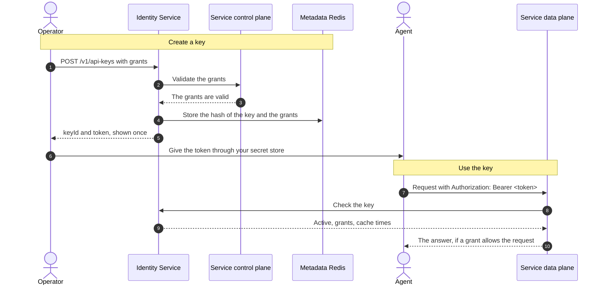

The Identity Service is the one place where a self-managed Redis Iris installation keeps the credentials of agents and applications. It does three things:

1. It issues agent keys. An agent key is a secret that an agent sends to a service's data plane, for example to Agent Memory.
1. It keeps the grants of each key. A grant says which resource the caller can use, and how.
1. It answers the data planes when they ask whether a key is valid, and what it can do.

This guide is for the platform administrator who installs the Identity Service, manages agent keys, and manages operator access. The `redis-iris` chart `1.0.0` always installs the Identity Service, as `iris-identity-service`. Its values go under the `identityService:` key, with the shared values under `global.iris`. It needs no license of its own, because the suite license covers it. To install, follow [Install the Redis Iris suite](/content/operate/iris/self-managed/_index.md), then [Deploy](/content/operate/iris/identity-service/self-managed/deploy.md).

## What you deploy

| Component | Purpose | Provided by |
| --- | --- | --- |
| Identity Service | Issues, lists, rotates, and revokes agent keys, and checks them for the data planes. The Service is always `iris-identity-service`, on port `9200`. | The suite chart |
| Control token Secret | The rescue credential for the control API. | The suite chart generates it, or you supply it |
| Runtime credentials and internal tokens | Shared Secrets between the Identity Service and each service. | The suite chart generates them, or you supply them |
| Metadata Redis | Stores the hashed agent keys and their grants. | You |

The chart deploys no Redis, no Ingress, and no NetworkPolicy for the Identity Service. It has no Transport Layer Security (TLS) listener: terminate TLS in your ingress, service mesh, or load balancer.

### Which services use it

| Service | `product` in grants | `resourceType` in grants | Guide |
| --- | --- | --- | --- |
| Agent Memory | `memory` | `mem-store` | [Self-managed Agent Memory](/content/operate/iris/agent-memory/self-managed/_index.md) |
| Agent Playbooks | `playbook` | `playbook` | [Self-managed Agent Playbooks](/content/operate/iris/agent-playbook/self-managed/_index.md) |
| Lens | `lens` | `lens-instance` | [Self-managed Lens](/content/operate/iris/lens/self-managed/_index.md) |
| Context Gateway | `context-gateway` | `gateway` | [Self-managed Context Gateway](/content/operate/iris/context-gateway/self-managed/_index.md) |
| Intent Router | `intent` | `intent-router` | [Self-managed Intent Router](/content/operate/iris/intent-router/self-managed/_index.md) |

### API surfaces

The Identity Service listens on one port and serves three groups of routes. Each group accepts a different credential, sent as `Authorization: Bearer <value>`.

| Route group | Routes | Caller | Credential |
| --- | --- | --- | --- |
| Control | `/v1/api-keys`, `/v1/products`, `/v1/subject-grants` | Operators, the Iris console, and automation | The control token, or an operator's identity provider (IdP) access token |
| Runtime | `/v1/auth/*` | Service data planes | The service's runtime credential |
| Operational | `/`, `/build-info`, `/health/liveness`, `/health/readiness` | Kubernetes probes and monitoring | None |

The operational routes need no credential, so don't expose them outside the cluster.

### How the components work together

1. An operator creates a resource in a service's control plane, such as an Agent Memory store.
1. The operator creates an agent key for that resource through the control API, or on the **API Keys** page of the Iris console.
1. Before it stores the key, the Identity Service asks the service's control plane to confirm that the resource exists and that the actions are valid. This step is called grant validation. If the control plane doesn't answer, the Identity Service refuses the grant with `424`.
1. The Identity Service returns the key once. It stores only a hash of the key.
1. The agent sends the key to the service's data plane. The data plane checks it with the Identity Service and caches the answer, so it doesn't ask for each request.

## Get started

1. Review the [prerequisites](/content/operate/iris/identity-service/self-managed/prerequisites.md).
1. Prepare the [configuration](/content/operate/iris/identity-service/self-managed/configuration.md).
1. [Install and check the Identity Service](/content/operate/iris/identity-service/self-managed/deploy.md) with the suite chart.
1. [Give an agent access with an agent key](/content/operate/iris/identity-service/self-managed/operations.md#give-an-agent-access-with-an-agent-key).
1. [Let operators sign in with your IdP](/content/operate/iris/identity-service/self-managed/authentication.md#operator-sign-in-with-your-identity-provider).

## Manage the deployment

- [Change, rotate, and revoke agent keys](/content/operate/iris/identity-service/self-managed/operations.md#change-rotate-and-revoke-a-key).
- [Rotate credentials, find who did what, upgrade, and back up](/content/operate/iris/identity-service/self-managed/operations.md).
- [Recover from a lockout](/content/operate/iris/identity-service/self-managed/authentication.md#recover-from-a-lockout).
- [Troubleshoot the deployment](/content/operate/iris/identity-service/self-managed/operations.md#troubleshooting).
